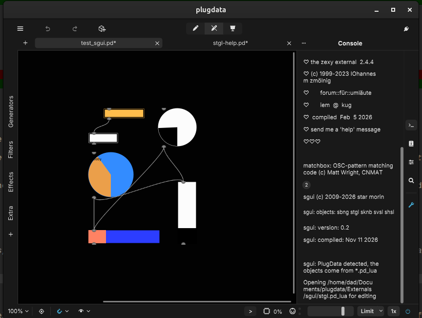
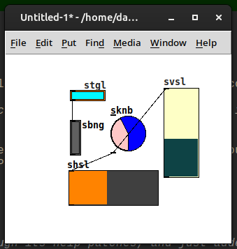

# sgui





Replacement IEM-style GUI objects for the Pure Data environment.

sgui is a **self-contained** pd external: it vendors the IEM-GUI helper
machinery (ported from pd-extended 0.44's `g_all_guis.c`) so it builds
against only the **public** `m_pd.h`. No pd internal headers
(`g_canvas.h`, `g_all_guis.h`, `s_stuff.h`, `t_tk.h`, ...) are needed, and
it runs on vanilla pd 0.5x and on PlugData (see *PlugData* below for what
renders there).

## Objects

| name   | what it is                          | also usable as |
|--------|-------------------------------------|----------------|
| `sbng` | resizable "smart" bang: an outline box whose inset rectangle flashes | `sbng` |
| `svsl` | vertical slider                     | `svsl`, and **shadows pd's built-in `vsl`** |
| `shsl` | horizontal slider                   | `shsl`, and **shadows pd's built-in `hsl`** |
| `stgl` | toggle: an outline box whose inset rectangle fills when on | `stgl`, and **shadows pd's built-in `tgl`** |
| `sknb` | rotary knob                         | `sknb`         |

### Shadowing

`svsl`/`shsl`/`stgl` register their class under the built-in names
`vsl`/`hsl`/`tgl` **and** keep their own `s`-prefixed name as an alias.
Because pd 0.5x registers object constructors in the `objectmaker` table,
registering a class under an already-taken name renames the old (built-in)
constructor to `<name>_aliased` and lets the new one win the name. The net
effect:

* In a patch, a plain `vsl`/`hsl`/`tgl` line uses the sgui object (once the
  matching sgui library has been loaded).
* The original built-in still works if you reference it explicitly as
  `vsl_aliased` / `hsl_aliased` / `tgl_aliased`.

The `s`-prefixed names always work and never collide.

### PlugData

PlugData has no Tk GUI, so the Tk drawing code sgui uses (`sys_vgui`) draws
nothing there. Instead PlugData draws any object whose *class* is named
`vsl`/`hsl`/`tgl` with its own native widget, reads the object's memory as
pd's modern `t_slider`/`t_toggle`, and calls pd's internal `iemgui_*`
functions on it. sgui's structs are therefore laid out to match modern pd
(including the `x_private` block those functions dereference), so in
PlugData:

* All five objects are drawn by pdlua versions (`sbng.pd_lua`,
  `svsl.pd_lua`, `shsl.pd_lua`, `stgl.pd_lua`, `sknb.pd_lua`), so they look
  as in vanilla: PlugData's own toggle is a square X and its sliders a thin
  value line, where sgui's are an inset rectangle and a solid bar. In edit
  mode they can be resized with the mouse (the knob stays square; sliders
  and the knob keep their value); the new size is saved. In PlugData,
  `vsl`/`hsl`/`tgl` stay PlugData's own widgets, since only the C objects
  shadow them. (The C structs still match modern pd's layout, so the C
  objects don't crash PlugData if they do get loaded there.) PlugData bundles pdlua and draws its GUI objects natively. They take the same
  arguments, messages and save format as the C objects, so patches move
  freely between vanilla and PlugData. pd's native loader runs before
  pdlua's, so the per-object C `.pd_linux` files must *not* be on
  PlugData's path (use `make install-plugdata`, below). The all-in-one `sgui`
  library detects PlugData and leaves all the objects to the Lua versions.
  Differences from the C objects:
  * labels are cut off at the object's edge, because pdlua clips drawing to
    the object box;
  * the properties (size, range, log/steady/init, colours, label,
    send/receive) are in PlugData's properties panel only with a pdlua that
    has the properties API, which PlugData 0.9.3 and older lack (it's on
    PlugData's development branch); until then, set them with the messages,
    or open the object's help (right-click → Help): it has an example
    instance and a panel of number/symbol/toggle boxes that set every
    property on it, with ELSE's `[colors]` pickers for the colours (ELSE
    comes with PlugData; in vanilla, without ELSE, they can't be created and
    the object's own properties dialog is the easier route); copy the
    configured example into your patch;
  * there are no `delta`/`pos` messages;
  * the knob has no shift-drag fine tuning (pdlua doesn't report modifier
    keys);
  * with init on, the initial output happens just after creation rather
    than on loadbang.

Purr Data loads all objects, but its JavaScript GUI cannot run the Tk drawing
commands, so they do not render there.

### Size

`sbng` and `stgl` have independent width and height (creation arguments,
properties dialog, or the `size <width> [<height>]` message; one argument
makes them square). `sknb` is always square.

## Requirements

* A C compiler (`cc`/`gcc`/`clang`).
* pd headers: a directory containing the public `m_pd.h`.
  On Linux distros that ship pd this is usually `/usr/include/pd` (or
  `/usr/local/include/pd`).

## Building

```sh
make
```

`make` auto-locates `m_pd.h` in this order:

1. `$PD_SRC` (env var or make variable: path to a pd **source tree**)
2. `/usr/include/pd`
3. `/usr/local/include/pd`
4. `./pd/src`

You can also point straight at the include directory: `make PDINC=/path/to/dir`
(where `m_pd.h` lives). If none of the above is found, `make` stops with a
clear error.

It builds **two kinds** of external:

* `sgui.pd_linux` — all five objects in one shared object. Load it
  explicitly with `pd -lib sgui` (or a `lib` message); its entry point is
  `sgui_setup`.
* `sbng.pd_linux`, `svsl.pd_linux`, `shsl.pd_linux`, `stgl.pd_linux`,
  `sknb.pd_linux` — one file per object name. pd loads these **on demand**
  when it meets the object in a patch (each entry point registers its own
  object). This is the usual way to use sgui: just drop the files on pd's
  search path and use the objects.

The on-demand files are the recommended installation, since they need no
explicit `-lib` and let pd load only what a patch actually uses.

On other platforms `make` picks the right suffix/flags automatically:
`pd_darwin` on macOS, `pd_win.dll` on MinGW.

## Installing

```sh
make install
```

copies the built externals and the `help/*.pd` files to
`~/Documents/Pd/externals/sgui/` (override with `make install INSTALL_DIR=...`).
Add that folder under Preferences → Path so pd finds the objects.

### Installing for PlugData

```sh
make install-plugdata
```

installs into `~/Documents/plugdata/Externals/sgui/` (override with
`make install-plugdata PLUGDATA_DIR=...`): the all-in-one `sgui` library
(which then only prints the banner), the `.pd_lua` objects and the help
files. PlugData only searches `Externals/` itself, not its subfolders,
so add `~/Documents/plugdata/Externals/sgui` under Settings → Paths (or put
`[declare -path sgui]` in the patch).

## Usage

Add the sgui directory (or the individual `.pd_linux` files) to pd's path,
or install as above. Then use the objects in patches exactly as you would the
built-in widgets:

```
[svsl  15 100 0 127 0 0 empty empty empty 0 -9 0 10 -99865 -89565 -262144 0 1]
[shsl 130 15 0 127 0 0 empty empty empty -2 -8 0 10 -99865 -89565 -262144 50 0]
[stgl  50 20 0 empty empty stgl 0 -6 0 10 -100465 -258689 0 1 2.5]
[sbng  50 20 50 50 0 empty empty sbng 0 -6 0 10 -99865 -89565 -1]
[sknb  75 75 0 127 0 0 empty empty empty 0 -8 0 8 -99865 -89565 -262144 50 1]
```

Colours can be given either as old-style integers (preset index, or the
negative packed RGB that pd < 0.51 saved) or as `#rrggbb` symbols, both as
creation arguments and in the `color` message. Patches are saved with
`#rrggbb` colours, the same format pd 0.51+ and PlugData use (so pd older than
0.51 cannot read them back).

Each object posts a one-line `sgui: <name> loaded` banner to the console when
its library is first loaded, which is a quick way to confirm sgui (and not a
built-in) is being used.

## Headless test

A patch instantiating all eight names (`sbng svsl shsl stgl sknb` plus the
shadowed `vsl hsl tgl`) can be smoke-tested without a display:

```sh
pd -nogui -stderr -batch -send "pd quit" sgui-test.pd
```

A correct build prints the five `sgui: ... loaded` banners and exits 0 with no
"couldn't create" / no errors. (The `-send "pd quit"` must come **before** the
patch file so pd has it queued before it opens the file.)

## Files

* `sgui.h` — private header: public-`m_pd.h` compat declarations + the vendored
  IEM-GUI API.
* `sgui_iem.c` — vendored IEM-GUI helper functions (pd-extended 0.44), with
  the `t_iemgui` layout matched to modern pd for PlugData.
* `sgui.c` — all-in-one entry point (`sgui_setup`).
* `sbng.c` `svsl.c` `shsl.c` `stgl.c` `sknb.c` — the objects.
* `*.pd_lua` — pdlua versions of the objects (for PlugData); `svsl.pd_lua`
  and `shsl.pd_lua` are the same code apart from their orientation settings.
* `help/*.pd` — help patches; `help/make-help.py` generates the five object
  help patches (run it after changing them there, not the `.pd` files).

## License

See `LICENSE.txt`. sgui is derived from Pure Data (Standard Improved BSD
License, Miller Puckette), the IEM-GUI objects (Thomas Musil, IEM KUG Graz),
and the sgui implementations (Star Morin).
